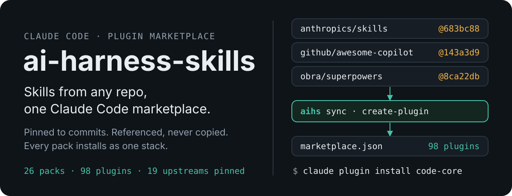
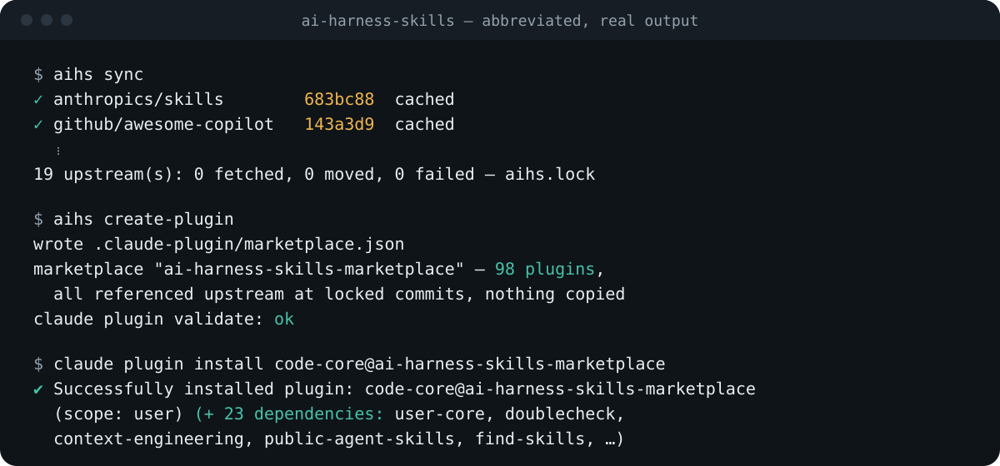
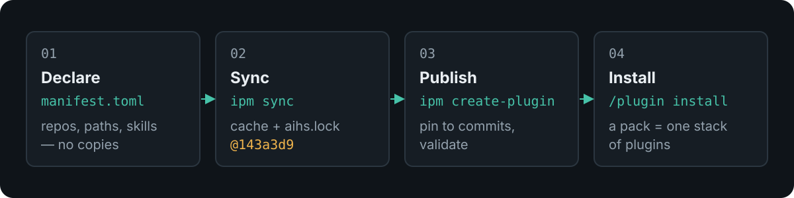

<p align="center">
  
</p>

<p align="center">
  
</p>

## What it is

A curated Claude Code plugin marketplace whose content lives in other people's repos. Each **pack** is a folder holding one `manifest.toml` that names upstream skills and plugins — Anthropic's skills, `obra/superpowers`, Cloudflare's skills, GitHub's awesome-copilot and more. The `aihs` CLI pins every upstream to a commit and writes `.claude-plugin/marketplace.json`, where every entry points back at its source. Install a pack and you get its whole stack.

## Why it is different

- **References, not copies.** A pack holds nothing but its `manifest.toml`. Marketplace entries point at the upstream repo (`github` or `git-subdir` sources), so Claude Code fetches each plugin at install time; nothing upstream is copied into this repo.
- **Pinned and reproducible.** As with npm, a manifest asks for a `version` (tag, branch or commit; latest default branch when omitted) and `aihs.lock` records the commit it resolved to. Each entry is published at that commit; upgrading is one deliberate command.
- **A pack is a stack.** Every pack is also a plugin that depends on everything it lists and on the packs it `includes`, so installing `code-core` brings in `user-core` and 23 plugins in all.
- **Copilot plugins' skills, as they are.** A `[[copilot-plugin]]` points at an awesome-copilot plugin; its skills — the same `SKILL.md` format — are published straight from upstream. Nothing is translated.

## How it works

<p align="center">
  
</p>

1. **Declare** — a pack's `manifest.toml` lists `[[plugin]]` upstreams and `[[copilot-plugin]]` items, each with an optional `version`.
2. **Sync** — `aihs sync` resolves each version to a commit, records it in `aihs.lock` (committed), and shallow-fetches it into `.aihs/cache/<owner>/<repo>/<commit>/` (gitignored).
3. **Publish** — `aihs create-plugin` pins every entry to its locked commit, writes the marketplace and runs `claude plugin validate`. It writes nothing else.
4. **Install** — Claude Code adds the marketplace and installs a pack, pulling in its dependencies.

## Quick start

Requirements: Go, git, [direnv](https://direnv.net), and Claude Code.

```bash
direnv allow                     # puts bin/aihs on PATH — the only setup
aihs sync                        # cache every upstream, pin it in aihs.lock
aihs create-plugin               # pin, write and validate the marketplace

claude plugin marketplace add "$PWD"
claude plugin install code-core@ai-harness-skills-marketplace
```

`aihs` is local to this checkout: it installs nothing globally, reads no global config, and is not on your PATH anywhere else.

## Packs

26 packs, 98 plugins. Install any pack by name: `claude plugin install <pack>@ai-harness-skills-marketplace`.

<details>
<summary><b>Engineering stacks</b> — code, testing, security</summary>

| Pack | What it brings |
| --- | --- |
| `user-core` | Universal skills for every project: context engineering, verification, skill tooling |
| `code-core` | Code quality gates: superpowers, code review, PR review, TDD guard, Matt Pocock's TDD and guardrail skills; includes `user-core` |
| `code-python` · `code-typescript` · `code-go` · `code-rust` · `code-java` · `code-csharp` · `code-mobile` | Language stacks: MCP server development and language skills |
| `test-core` | Testing automation and web app testing |
| `security-core` | Security best practices |
| `code-architecture` · `eng-best-practices` | Architecture standards; Cloudflare, Matt Pocock's engineering skills, UI design |

</details>

<details>
<summary><b>Architecture and operations</b></summary>

| Pack | What it brings |
| --- | --- |
| `architect-cloud` | Cloud architecture: Azure development, cloud design patterns, Supabase |
| `architect-devops` | DevOps on-call triage |
| `architect-dataops` | Databases, PostgreSQL, SQL optimisation |
| `architect-mlops` | LLM observability and evaluation (Arize AX) |

</details>

<details>
<summary><b>AI, design, planning and documents</b></summary>

| Pack | What it brings |
| --- | --- |
| `ai-agents` | Agent SDK and MCP server development, Copilot SDK, Arize AX |
| `ai-tooling` | `apm-retrofit`: turn an existing skills repo into an APM package |
| `agentic-harness` | Anthropic's skill-creator |
| `design-frontend` · `graphic-design` | Frontend design, canvas and theme skills; Gemini API, draw.io |
| `plan-core` | Project planning skills |
| `plan-docs` | Word, PDF, PowerPoint, Excel, doc co-authoring, internal comms |
| `business-core` · `productivity` | Business workflow skills; Obsidian vaults |

</details>

## Commands

| Command | Does |
| --- | --- |
| `aihs sync [--upgrade]` | Resolve every upstream's version to a commit, pin it in `aihs.lock` and cache it; `--upgrade` re-resolves every version |
| `aihs create-plugin [--pack NAME]… [--dry-run]` | Write `.claude-plugin/marketplace.json` with every entry pinned, then validate it |
| `aihs doctor` | Check config, every manifest, the lock and the marketplace |
| `aihs help [command]` | Usage, or one command's flags |

## Limits

- **Claude Code only.** Antigravity and Codex output is not built yet.
- **Copilot agents and instructions are not published.** Claude Code loads plugin agents only from an `agents/` folder inside the plugin, and awesome-copilot keeps them at its repo root; no plugin component loads a Copilot `*.instructions.md`. With items removed upstream, 96 references are recorded as unpublished, each listed with its reason at the end of its pack's `manifest.toml`.
- **Hooks and MCP servers come only from Claude Code plugins.** An upstream Claude Code plugin is published as it is, hooks and MCP servers included; those in Copilot plugins are skipped, never translated.
- **Local install only, for now.** This checkout has no git remote yet; once pushed, others can add it with `claude plugin marketplace add <owner>/<repo>`.

## Documentation

- [User guide](docs/user-guide.md) — install, add and update packs, pin versions, troubleshoot.
- [Manifest reference](docs/manifest-reference.md) — every table and key in `manifest.toml`, and `aihs.lock`.
- [Architecture](docs/architecture.md) — how `aihs` is built and why.
- [`cli/README.md`](cli/README.md) — working on `aihs` itself.

<p align="center"><sub>Maintained by Dr Gene Conroy-Jones.</sub></p>
