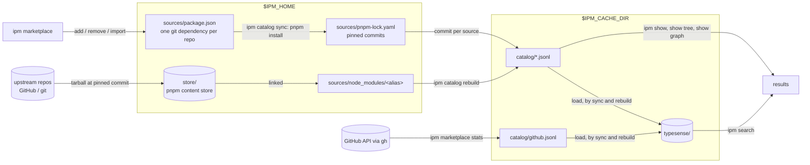
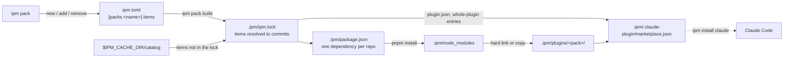

# Architecture

How `ipm` turns a list of repos into a searchable catalog of agent artifacts, builds packs of picked items into Claude Code plugins, and why it is built this way. For day-to-day use see the [guides](guides/index.md); for the sources files see the [sources reference](reference/sources.md). The full design is [the ipm design](https://github.com/thinkjones/intelligent-package-manager/blob/main/docs/superpowers/specs/2026-10-09-ipm-design.md).

## Purpose and boundaries

`ipm` lets a person find agent artifacts — skills, agents, commands, hooks, MCP servers, plugins, Copilot plugins and marketplaces — across many upstream repos. It owns four things: the user's **sources** (a pnpm project listing repos of interest), the **catalog** built from them, a local **search index** over the catalog, and **packs** — named sets of picked items in a project's `ipm.toml` — which `ipm pack build` builds into Claude Code plugins and a marketplace under `.ipm/`.

It deliberately does not own fetching (pnpm does that) or upstream content (read in place, never modified or executed). It installs into Claude Code only when asked: `ipm install claude` (or `D` in the TUI) runs `claude plugin` commands that the user sees first.

## System overview



## Where things live

Paths are resolved in `internal/paths`, following pnpm's conventions. Both roots must be absolute.

| Root | Override | macOS | Linux | Windows |
| --- | --- | --- | --- | --- |
| Home | `IPM_HOME` | `~/Library/ipm` | `$XDG_DATA_HOME/ipm`, else `~/.local/share/ipm` | `%LOCALAPPDATA%\ipm` |
| Cache | `IPM_CACHE_DIR` | `~/Library/Caches/ipm` | `$XDG_CACHE_HOME/ipm`, else `~/.cache/ipm` | `%LOCALAPPDATA%\ipm\cache` |

`XDG_DATA_HOME` and `XDG_CACHE_HOME` are honoured on every OS. The home holds what a user would lose — `sources/` (`package.json`, `pnpm-lock.yaml`, `node_modules/`, the generated `.pnpmfile.cjs`) and `store/`, a pnpm store dedicated to `ipm` (pnpm's docs say a store is for mutually trusted users and processes). The cache holds what `ipm` can rebuild: `catalog/`, `typesense/` and `curated/` (the last curated list `ipm onboard` fetched).

Nothing is kept in the directory `ipm` runs from, so every command works anywhere. Packs live with the project that uses them (next section); user-scope packs live in `$IPM_HOME/global/`.

## Sources

`internal/sources` owns `sources/package.json`: `{"name":"ipm-sources","private":true,"dependencies":{…}}`, one entry per repo, keyed by an alias (`owner--repo`, lowercased) with a pnpm specifier (`github:owner/repo[#ref]` or `git+<url>[#ref]`). `ipm marketplace add`, `remove` and `import` edit it; adding a repo already listed, or one whose alias collides with another's, is refused. `Checkouts` pairs each source with `node_modules/<alias>` (symlinks resolved) and the 40-character commit in its `pnpm-lock.yaml` entry; a source missing either is an error that says to run `ipm catalog sync`.

## `ipm catalog sync`

1. Find pnpm (`internal/cli/pnpm.go`): pnpm from PATH if its major version is 12 or more, else `npx -y pnpm@12.10.1`; with neither, an error naming pnpm.
2. Write `sources/.pnpmfile.cjs`.
3. Run `pnpm install` (with `--upgrade`, `pnpm update --latest`) with `--ignore-scripts --store-dir <home>/store --dir <home>/sources`.
4. If pnpm fails, print its output and exit 1; the catalog is left as it was. Otherwise run `ipm catalog rebuild`'s indexing step, which also loads the search index when the search server is up (and prints a hint to run `ipm catalog serve` when it is not).

### Why the pnpmfile

pnpm fetches a GitHub dependency as a codeload tarball but treats it as a git-hosted package and re-packs it with npm's packing rules (`package.json` `files`, `.npmignore`). For repos that are also npm packages that strips the agent content — `nizos/tdd-guard` went from 429 files to 3. The generated `.pnpmfile.cjs` does two things:

- a custom fetcher (pnpm 12's `fetchers` hook, `{ delegate }` form) that fetches the same commit as a plain `https://github.com/<owner>/<repo>/archive/<sha>.tar.gz` tarball, which pnpm unpacks as it is;
- a `readPackage` hook that empties every source's `dependencies`, `optionalDependencies` and `peerDependencies`, so their npm dependencies are never installed.

Non-GitHub sources (`git+https`, `git+ssh`, `git+file`) do not match the fetcher and still go through pnpm's git fetcher, so npm's packing rules can still drop files from them.

## Catalog

`ipm catalog rebuild` turns the synced sources into a searchable record of what they hold, without copying anything. It reads only `sources/node_modules` and `pnpm-lock.yaml`, so the same pins always produce byte-identical files (records sorted by ID, one per line). The catalog is rebuildable and lives in the cache; it is not committed anywhere.

- **Walk** (`internal/catalog/walk.go`) finds markers: `SKILL.md`, `agents/**/*.md`, `commands/*.md`, `hooks/hooks.json`, `.mcp.json`, `.claude-plugin/plugin.json`, Copilot `plugin.json`, `.claude-plugin/marketplace.json`.
- **Parse** (`parse.go`, `plugin.go`) turns each into a record: stable ID, repo, commit, path, the frontmatter or JSON verbatim as `meta`, a content hash. Frontmatter that is not strict YAML falls back to plain `key: value` lines, with the error kept on the record.
- **Link** (`link.go`) decides which plugin owns which component by Claude Code's own rules — skills add to `skills/`, agents and commands replace their defaults, hooks and MCP merge — and resolves marketplace entries to local, inline or external plugins.
- **Build** (`build.go`) adds a `repo:` record per source and per external source repo, and the reverse links: each component's `plugins`, each plugin's `marketplaces`.
- **Stats** (`internal/github`) are kept apart in `github.jsonl` because stars change daily; `ipm marketplace stats` refreshes them on demand through `gh`, and `ipm catalog rebuild` leaves the file alone.

An external plugin's catalog ID (`plugin:<marketplace repo>#<name>`) can be given to `ipm marketplace add`, which adds the repo the plugin lives in. Record fields are in [the catalog spec](https://github.com/thinkjones/intelligent-package-manager/blob/main/docs/superpowers/specs/2026-10-08-artifact-catalog-design.md#data-model).

## Search

`ipm catalog serve` runs Typesense 30.2 in Docker as container `ipm-typesense` on `127.0.0.1:8108`, with its data and API key in `<cache>/typesense/`. If a container from the aihs days (`aihs-typesense`) exists, `serve` removes it first, since it holds the port; run `ipm catalog rebuild` afterwards. Loading (done by `ipm catalog rebuild` and `ipm catalog sync` when the server is up) rebuilds one collection, `artifacts`, from `catalog/*.jsonl` and `github.jsonl`: one document per record, with its repo's stars (an external plugin takes its source repo's), its owning plugins' names, and an embedding Typesense computes itself with its built-in `ts/all-MiniLM-L12-v2` model. The index is disposable — the catalog is the record — so there is no incremental sync.

`ipm search` runs hybrid search by default: keyword matching over name (weight 4), repo and owning plugins' names (3 each), description and tags (2 each), fused with semantic matching on the embedding (Typesense's rank fusion, 0.7 keyword / 0.3 vector), ties broken by `used_by` (how many other repos reference the document's repo), then stars. Names are split on `/`, `-` and `_`. A search naming a field an older index lacks maps to "the search index is from an older ipm — run ipm catalog rebuild". `--keyword` turns semantics off for comparison. The SCORE column is the hybrid rank-fusion score × 100 — relative standing within one query, not comparable across queries — or, with `--keyword`, the keyword score as a percentage of the best hit's. `--explain` adds KW (✓ for a keyword match, — for semantic-only) and SEM (semantic similarity, 1 − cosine distance, comparable across queries). `--page N` pages through results; `--all` fetches every page, 250 at a time — in hybrid mode that is the keyword matches plus about 100 semantic neighbours. `#` and `+` are indexed, so `c#` and `c++` are words. The code is `internal/typesense` (a plain `net/http` client) and `internal/search` (documents, schema, parameters, the results table).

`ipm show`, `ipm show tree` and `ipm show graph` read the catalog only, through `internal/catgraph`: repos contain their marketplaces, marketplaces list plugins, and plugins own components; repos are roots, so `tree --up` from a skill stops at its repo. Which other repos' marketplaces list it is a reference, not containment: `ipm show` lists it under `used by:`, and the TUI under `e` (see References between repos).

## Packs, `ipm pack build` and `ipm install`



### Scope

`internal/project` finds the scope root: in a project, the nearest ancestor of the working directory holding `ipm.toml` (`ipm pack new` creates `ipm.toml` in the working directory if there is none); with `-g`, `$IPM_HOME/global`. Generated files go in `<root>/.ipm/`.

### `ipm.toml` and `ipm pack`

```toml
[packs.csharp-sdlc]
description = "C# development lifecycle"
items = [
  "skill:wshobson/agents:plugins/dotnet-contribution/skills/dotnet-backend-patterns",
  "plugin:anthropics/claude-plugins-official#stripe",
]
```

Items are catalog IDs and carry no commit. `ipm pack add` checks each against the catalog. Pickable: skills, agents and file-based commands (placed in the pack's plugin), Copilot plugins (their skills are added), and whole plugins — local, inline or external — which become dependencies. Hooks, MCP servers and inline commands are not pickable on their own: `pack add` refuses and prints the `ipm pack add <pack> <plugin id>` that adds the owning plugin. Repos and marketplaces are refused with a pointer to `ipm show tree <id>`. Pack names follow the naming rules in `internal/pack`, which also refuse names Claude Code reserves (`claude-…`, `anthropic-…`, `official` beside claude or anthropic). Removing hooks or MCP servers from a whole plugin is left for later.

### `ipm pack build`

1. **Resolve** (`internal/assemble`): every item from `.ipm/ipm.lock` first, then the catalog; an item in neither is an error that names it. Existing pins are kept; `--update` re-resolves every item from the current catalog.
2. **Plan** (`assemble.Build`): each pack's files and whole-plugin dependencies. Refuses unpickable types, items with no usable name, and marketplace entry names that clash with each other or with a pack; warns about external plugins whose upstream entry names no commit.
3. **Fetch**: write `.ipm/package.json` (one dependency per source repo, `github:Owner/Repo#<sha>` or `git+<url>#<sha>`, through `sources.WriteProject`), `.ipm/.pnpmfile.cjs` and `.ipm/.gitignore` (`node_modules/`, `plugins/`, `plugins.tmp/`), then run pnpm exactly as `ipm catalog sync` does, with `--dir <root>/.ipm`. Pins are per repo, not per item: the fetcher hook fetches whole commits, and the store shares them anyway.
4. **Place**: build into `.ipm/plugins.tmp/<pack>/`, putting each picked skill folder, agent and command there (`skills/<name>/`, `agents/<name>.md`, `commands/<name>.md`) by hard link from `.ipm/node_modules`, copying (with the file's mode) when linking fails across volumes. Symlinks are resolved first and every source must stay inside its repo. A name clash within a pack gets `-<repo owner>` appended, then `-2`, `-3`. When every pack is placed, `plugins.tmp/` replaces `plugins/`.
5. **plugin.json**: `name` = pack, `description`, `version` `0.0.0-ipm`, `author` (git `user.name` or `ipm`), `dependencies` (the pack's whole-plugin entries), and `metadata.ipm.items` — `{id, type, name, repo, path, sha, file}` per placed file, the provenance.
6. **Marketplace and lock**: `.ipm/.claude-plugin/marketplace.json`, named `<project dir>-ipm` (user scope `ipm-global`), listing each pack as `./plugins/<pack>` and each whole plugin as `<pack>-<name>`, pinned to its commit (a local plugin as a `git-subdir` source, an inline or external one as its upstream entry), all tagged `ipm`. Built by `internal/marketplace`. Then `.ipm/ipm.lock` (TOML, one `[[item]]` per picked item — id, type, name, repo, path, commit, and a whole plugin's marketplace source — sorted by id) is written last, so a failed build leaves the previous plugins and lock in place.
7. **Validate**: `claude plugin validate --strict .ipm`, skipped with a note when `claude` is not on PATH or with `--no-validate`; a failure exits 1.
8. **Stamp**: `.ipm/build.stamp`, written last, is the hex SHA-256 of the packs in `ipm.toml` (name, description and items; install records are left out), the `ipm.lock` bytes just written and the ipm version. `ipm install <target>` computes the same hash from the current `ipm.toml` and the existing `ipm.lock`; when it matches and `.ipm/plugins/` and the marketplace file exist it skips the build and prints `build is current`. `--update` always rebuilds. The stamp is part of the deterministic output.

The build ends by printing `Install in Claude Code: ipm install claude` and the `claude plugin marketplace add` line for wiring it by hand.

Two runs give byte-identical output, and items removed from a pack leave no files. `ipm.toml` and `.ipm/ipm.lock` are committed by other people, so they are untrusted input: pack names must be valid names, lock paths must be local to their repo, commits must be full SHAs, and a malformed lock entry is an error naming the item. Because the lock and pins are committed, a teammate can run `ipm pack build` from `ipm.toml` and `.ipm/ipm.lock` without a catalog. In Claude Code, picked items load under the pack's name (`<pack>:<item>`; commands show as skills); whole plugins keep their own names and are installed as dependencies.

## `ipm tui`

`internal/tui` is a [Bubble Tea](https://github.com/charmbracelet/bubbletea) model for the curation loop, in two modes: **search mode** (results in the top panel, 40% of the height, with the tree below following the selected result) and **tree mode** (focus in the tree, walking siblings and levels). The active pack is a tray along the bottom; modals cover the pack picker, build and deploy output, the deploy steps (which install into Claude Code) and help. It depends only on five interfaces in `deps.go`; `internal/cli/tui.go` implements them:

| Interface | Implementation |
| --- | --- |
| `Searcher` | Typesense (the same `search.Query` as `ipm search`, 50 hits) when the server answers and its index has documents; otherwise keyword matching over the catalog: 4 per query word in the name, 1 in the description and in tags, ties by stars. `ctrl+r` checks again. |
| `Catalog` | `catgraph`: `Node(id)` with its fields, stars, and parents and children with their descriptions. |
| `Packs` | `createPack`, `addToPack`, `removeFromPack`: the functions behind `ipm pack`, so the same pick rules apply. |
| `Installer` | `runBuild` (`ipm pack build`) with its output piped into the modal line by line. |
| `Deployer` | `claudeDefaults`, `cleanTarget`, `planDeploy` and `installClaude`: the code behind `ipm install claude`. |

**The tree** (`tree.go`) is a pure function, `buildTree(catalog, id, chosen)`: the path from the node's root to its parent (following the first parent, or the one chosen in tree mode), its siblings, its children and its other parents ("also in"). The renderer cuts names to 24 cells and type labels to 6, so descriptions start in one column; the cursor's description wraps to three lines; long lists scroll around the cursor. Searches run 150 ms after the last keystroke and carry a sequence number, so a slow result for an old query is dropped. Pack edits write `ipm.toml` at once; `.ipm/` changes only on build. `NO_COLOR` strips colour from the finished screen.

## `ipm install claude`

`ipm install claude [pack]` (and the TUI's `D`) builds when `.ipm/` is stale (see the stamp above), then plans and runs `claude` commands through `System.Output`: `claude plugin marketplace add <project>/.ipm --scope S` always (Claude Code accepts a repeat, and the marketplace must be declared at the target scope), `claude plugin marketplace update <name>` when `claude plugin marketplace list --json` already lists it, then `claude plugin install <pack>@<name> --scope S`, or `claude plugin update` when `claude plugin list --json` shows it installed at that scope and folder. Project and local scope run in the chosen folder. The marketplace name comes from `marketName` (the same function `ipm pack build` uses), so the TUI can show the commands before the first build. `--dry-run` prints those commands without building, running or recording anything. After a successful install the command records it: `[[packs.<name>.installs]]` entries in the project's `ipm.toml` (paths inside the project stored relative to it) for project packs, and `$IPM_HOME/installs.json` (a sorted JSON array with absolute paths) for user-scope packs. Reinstalling the same pack to the same target and path replaces its record. Bare `ipm install` replays every recorded install in the scope, and `ipm pack show` lists a pack's installs. Claude Code reads an installed ipm pack in place from `.ipm/plugins/<pack>`; a rebuild takes effect at its next session.

## References between repos

`catalog.BuildRefs` finds every **external entry** — a marketplace entry whose `source_repo` is another repo — and resolves what it references: the source repo's plugin at the entry's source path, else the one with its name, else the repo's only plugin, else the repo record. A source repo that isn't one of the user's sources only has a placeholder record (`followed: false`), which is never a target, so the entry is unresolved. `catgraph` keeps these apart from containment: repos never have parents, `RefTarget`, `RefsTo`, `RefsInto` and `UsedBy` answer the reference questions, and `ipm show tree` stops at an external entry with a `↗ <target>` line. `internal/search` uses the same function for each document's `used_by` and `external` fields. In the TUI, `→` on an external entry jumps to its target with a back stack drawn as a second root, and `e` lists a repo's references.

## `ipm onboard` and `ipm uninstall`

`ipm onboard` (`internal/cli/onboard.go`) chains existing commands. It first looks for data — sources in `sources/package.json` or a catalog — and keeps it or backs it up by renaming home, then cache, to `<dir>.backup-YYYYMMDD-HHMM`; if the second rename fails the first is undone. `internal/curated` fetches the curated list (a URL is cached under `<cache>/curated/` and reused when offline; a path is read as is) and groups its `[[repos]]` rows into lists. The picks come from `--lists`, `--yes` (the default lists) or the checklist (`internal/tui/checklist.go`, its own Bubble Tea model, where sources already followed are locked). It prints the four concepts first (marketplace, catalog, pack, install). Then it calls `sources.AddSkippingExisting`, `syncSources`, `runStats` (skipped without a logged-in `gh`), and `runServe` with `runLoad` (skipped without Docker), stopping at the first failure with the command to rerun.

`ipm uninstall` (`internal/cli/uninstall.go`) checks everything before removing anything: it refuses a development build (the binary's folder is `bin` and an ancestor holds `.git` and `cli/go.mod`) without `--force`, and with `--purge` asks for the home path. Then it removes the `ipm-typesense` container, the binary, and with `--purge` the home and cache.

## `ipm doctor`

One row each for `home`, `cache`, `pnpm` (the version, and whether it runs through `npx`), `sources` (count; a warning if not all are synced), `catalog` (record count; a warning if not built), `docker`, `typesense` and `claude` (a warning if not on PATH). A missing home or pnpm is a problem and exits 1; warnings do not.

## Code layout

```text
cli/
├── cmd/ipm/main.go           process wiring only: argv, real commands, HTTP client, exit codes
└── internal/
    ├── cli/                   the Cobra command tree (cli.go), one file per command (packcmd.go, install.go, …); pnpm.go (find pnpm, .pnpmfile.cjs)
    ├── paths/                 IPM_HOME, the cache dir, the folders under them
    ├── sources/               sources/package.json, aliases, pnpm-lock.yaml commits; WriteProject for .ipm/package.json
    ├── catalog/               walk, parse, link, build; *.jsonl read and write
    ├── github/                GitHub stats through gh
    ├── typesense/             Typesense HTTP client
    ├── search/                documents, schema, parameters, results table
    ├── catgraph/              the catalog as a graph; tree and graph rendering
    ├── scan/                  the folder report behind ipm catalog scan
    ├── project/               scope root, ipm.toml packs, .ipm/ipm.lock
    ├── assemble/              resolve picks, plan each pack, place files by hard link
    ├── pack/                  naming rules; reading an aihs-era manifest.toml for source import
    ├── copilot/               the skills a Copilot plugin.json lists
    ├── marketplace/           marketplace.json entries (ipm's own or upstream entry maps) and atomic Write
    ├── curated/               read and write curated source lists ([[repos]] TOML) for ipm onboard and ipm marketplace; fetch with a cached fallback
    ├── sourcepacks/           maintain source-packs.toml from a wider list of repos (run by cmd/sourcepacks, a maintainer's tool)
    └── tui/                   the Bubble Tea model behind ipm tui (tree.go, deploy.go), over five interfaces (deps.go); checklist.go, ipm onboard's picker
```

Commands reach the outside world only through `cli.System` (stdout, stderr, environment, `LookPath`, an `Output` runner for pnpm, docker, gh and claude, an HTTP client and a clock). `go install …/cli/cmd/ipm` builds the same binary. In a clone, `bin/ipm` at the root is a shell shim: it rebuilds `cli/bin/ipm` when a Go source changes and execs it; `install.sh` at the root builds the checkout into `~/.local/bin/ipm` (or `$IPM_BIN_DIR`), or, piped from curl, runs `go install …@latest` there; `.envrc` no longer touches `PATH`, so the `ipm` on `PATH` is the installed one and `bin/ipm <command>` runs the development build.

## Decisions

| Decision | Rationale |
| --- | --- |
| pnpm is the fetcher, pinner and store | It already solves fetching git dependencies, pinning them in a lockfile, a shared content-addressable store and cheap linking; `ipm` doesn't reimplement any of it. |
| Always `--ignore-scripts`; sources' npm dependencies emptied | Sources are content, not code. No upstream file is ever executed. |
| A generated `.pnpmfile.cjs` fetches GitHub commits as plain tarballs | pnpm's re-packing with npm's rules dropped agent content from repos that are also npm packages. Needs pnpm 12's custom fetchers, hence the pnpm 12 floor and the `npx` fallback. |
| A dedicated pnpm store under the home | A pnpm store is for mutually trusted users and processes; agent repos are kept apart from a user's normal store. |
| Sources and catalog per user, in platform data and cache folders | Like pnpm's registry config and metadata cache: one list of interests per person, usable from any project. The catalog is rebuildable, so it is cache, not data. |
| Catalog kept separate from GitHub stats | The catalog is a pure function of the pinned commits; stars change daily and are refreshed on demand. |
| Disposable search index | The catalog is the record; `ipm catalog rebuild` rebuilds the index rather than syncing it. |
| Packs are built per project in `.ipm/`, committed except `plugins/` and `node_modules/` | A team shares the pack definition and its pins; anyone rebuilds the same plugin with `ipm pack build`, without the author's catalog. |
| Picked files are hard-linked, not copied or symlinked | No extra disk and no new dependency; Claude Code loads them like any plugin files. Copy is the fallback across volumes. |
| Whole plugins are marketplace dependencies, not copies | They keep their own namespace, hooks and MCP servers, and stay pinned to an upstream commit. |
| `ipm` installs into Claude Code only on `ipm install claude` | Installing changes the user's Claude config, so it is an explicit command (or a confirmed TUI step showing the exact `claude` commands), never a side effect of building. |
| All commands in Go, one test suite | One language, and every command is testable in-process through `cli.System`. |

## Testing

`mise run verify` runs the format and lint checks, `go build`, `go vet` and `go test ./...`:

- `internal/paths` resolves defaults and overrides for macOS, Linux and Windows, and refuses relative paths and a missing home.
- `internal/sources` tests aliases, the `package.json` round trip, duplicate and colliding repos, and reading commits from a fixture `pnpm-lock.yaml`, including unsynced cases.
- `internal/project` tests the scope walk and the `ipm.toml` and lock round trips; `internal/assemble` tests resolving from lock then catalog, name clashes, Copilot plugins, whole-plugin entries, hard link falling back to copy, and stale files removed.
- `internal/catalog`, `internal/catgraph`, `internal/search` and `internal/typesense` test the catalog, the graph and search against fixtures and an `httptest` server.
- `internal/cli` drives every command in-process with a fake `System` and temp `IPM_HOME`/`IPM_CACHE_DIR`: the exact pnpm arguments, the generated `.pnpmfile.cjs`, the `npx` fallback for an old pnpm, a failed pnpm leaving the catalog intact, doctor rows, `ipm pack` refusals and scopes, and `ipm pack build` pins, determinism, installing from the lock alone and validation.
- `cmd/ipm` builds the real binary and checks exit codes.

`mise run test:integration` adds the tests behind the `integration` build tag, also in `cmd/ipm`: with real pnpm and Node, `marketplace add`, `catalog sync`, `catalog sync --upgrade` and `ipm pack build` against local git repos over `file://`; with Docker as well, `ipm catalog serve`, `ipm catalog rebuild` and `ipm search` against a real Typesense. CI runs them; locally the search test refuses to run beside an existing `ipm-typesense` container.

## Extending

- **A command** — add `internal/cli/<name>.go` with a `new<Name>Cmd(sys System) *cobra.Command`, register it in `newRootCmd`, and check its arguments with `noArgs`, `exactArgs`, `minArgs` or `verbs` so a malformed command line exits 2. Get data folders from `ipmPaths(sys)`.
- **Another artifact type** — add a marker to `internal/catalog/walk.go`, a parser, a type in `catalog.Types` with its file, and fixtures.
- **A pickable type** — teach `ipm pack add` to accept it (`internal/cli/packcmd.go`) and `internal/assemble` where to place it.
- **A TUI feature** — add state and keys to the model in `internal/tui` (tested against the fakes in `model_test.go`); if it needs something new from ipm, add a method to one of the four interfaces in `deps.go` and implement it in `internal/cli/tui.go` over existing CLI code.
