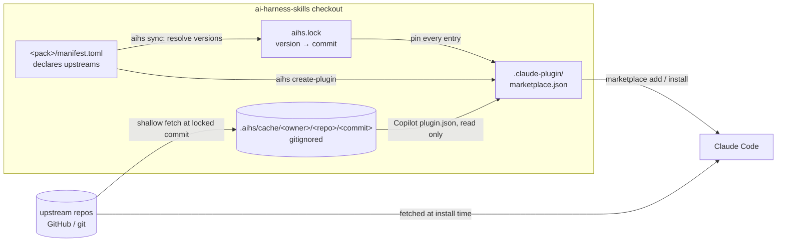
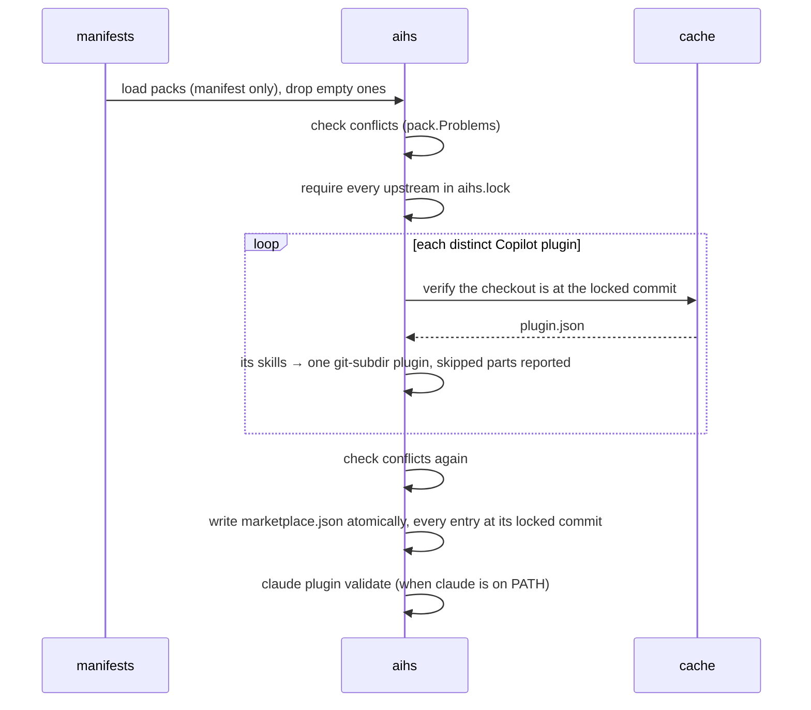
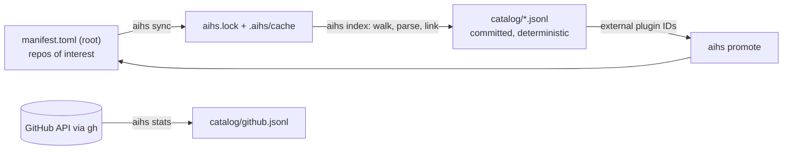

# Architecture

How `aihs` turns a folder of `manifest.toml` files into a Claude Code plugin marketplace, and why it is built this way. For day-to-day use see the [user guide](user-guide.md); for every manifest key see the [manifest reference](manifest-reference.md).

## Purpose and boundaries

ai-harness-skills curates skills and plugins that live in other repositories and publishes them as one Claude Code marketplace. It owns three things: the **packs** (each a folder holding only a `manifest.toml`), the **`aihs` CLI** that builds the marketplace from them, and two **generated files** (`aihs.lock` and `.claude-plugin/marketplace.json`).

It deliberately does not own upstream content (it only references it and never copies or rewrites it), any global state (`aihs` is local to the checkout), or installation (Claude Code installs plugins; `aihs` only describes them).

## System overview



Claude Code gets every plugin straight from its upstream repo: each marketplace entry names the repo, a subdirectory and the locked commit, and Claude Code fetches it at install time. The cache exists so `aihs` can read what it needs to know — a Copilot plugin's list of skills — at exactly the commit it publishes.

## Data model

| Concept | Where it lives | Meaning |
| --- | --- | --- |
| Pack | a root directory holding only `manifest.toml` | A curated set; also published as a *stack* plugin named after the directory. |
| `[[plugin]]` | manifest | An upstream Claude Code plugin, or upstream skill folders, referenced in place. |
| `[[copilot-plugin]]` | manifest | A GitHub Copilot plugin whose skills are referenced in place. |
| `[pack] includes` | manifest | Other packs this stack builds on. |
| `version` | manifest | A tag, branch or commit, npm style; omitted means the default branch. |
| Upstream | derived | A repo plus a version: `owner/repo@version`. |
| Lock | `aihs.lock` | The commit each upstream's version resolved to. Committed. |
| Cache | `.aihs/cache/<owner>/<repo>/<commit>/` | A shallow checkout of each locked commit. Gitignored. |

## Versions, the lock and the cache

Versions follow npm's git-dependency convention. A manifest's `version` is like npm's `#commit-ish`: a tag, a branch or a commit; without one, the upstream's default branch. `aihs.lock` plays the part of `package-lock.json`: it records, per upstream, the requested version and the commit it resolved to, and every marketplace entry is published at that commit.

The cache is keyed by commit, not by tag or branch, because a commit cannot move: `.aihs/cache/github/awesome-copilot/143a3d9…/` always holds the same files. Two versions that resolve to the same commit share one checkout.

## Commands as pipelines

### `aihs sync`

1. Load every pack and collect its upstreams (`pack.Upstreams`), each once.
2. Resolve each upstream to a commit: a `version` that is already a commit, else the locked commit, else (or with `--upgrade`) the remote's, via `git ls-remote` — requesting the peeled `^{}` form so an annotated tag resolves to its commit.
3. Fetch each distinct repo-and-commit not already cached, once: `git fetch --depth 1 <url> <commit>` and a detached checkout. Up to four run in parallel.
4. Write `aihs.lock`, then prune cached commits no upstream is locked to. A failed upstream keeps its previous commit.

### `aihs create-plugin`



A Copilot plugin listed by several packs is expanded once and published once.

### `aihs doctor`

Loads each pack independently and reports problems (a pack holding anything but `manifest.toml`, malformed manifests, conflicting definitions, bad includes) and warnings (packs that publish nothing, unpinned upstreams, a marketplace `aihs` did not write, `claude` missing from PATH). Exit code 1 means at least one problem.

## Copilot plugins

A GitHub Copilot plugin is an [agent-plugins.org](https://agent-plugins.org) `plugin.json` whose components sit under vendor extensions; awesome-copilot's `com.github.awesome-copilot` extension lists `skills` and `agents`. `aihs` resolves those paths the way awesome-copilot's own `eng/materialize-plugins.mjs` does (beside `plugin.json`, else at the repo root) and publishes:

| Component | Published? | Why |
| --- | --- | --- |
| Skills | Yes — one `git-subdir` plugin over their folder, named for the Copilot plugin | Standard `SKILL.md`, loadable as is. |
| Agents | No — reported as skipped | Claude Code loads plugin agents only from an `agents/` folder inside the plugin. awesome-copilot keeps `agents/` at its repo root, so the plugin would have to be the whole repository: 214 MB per plugin, plus all 426 of its skills. |
| Hooks, MCP servers, other extensions | No — reported as skipped | Not translated from other tools' conventions. |

A Copilot plugin with no skills publishes nothing and is an error. Standalone Copilot agents (`*.agent.md`) and instructions (`*.instructions.md`) have no Claude Code plugin form that loads them as is; manifests record them as not published.

Upstream **Claude Code** plugins are a different matter: they are published as they are, hooks and MCP servers included.

## Marketplace shape

Every entry carries the tag `aihs`; that is how `create-plugin` recognises a `marketplace.json` it wrote and may overwrite (`--force` overrides). Entries come in two shapes:

- **Upstream** — `source` is `{"source": "github" | "git-subdir" | "url", …, "ref": <version>, "sha": <locked commit>}` (`ref` only when the version names a branch or tag), with `skills` when the manifest lists them. No `strict`, `commands` or `agents` keys, so an upstream `plugin.json` stays in charge.
- **Stack** — `source` is `"./<pack>"` (a folder holding only `manifest.toml`), `strict: false`, `commands: []`, `agents: []`, and `dependencies` on every plugin the pack lists and every pack it includes.

The file sits at the checkout root because Claude Code resolves relative sources against the directory holding `.claude-plugin/` and forbids `../`.

## Catalog

`aihs index` turns the repos of interest (the root `manifest.toml`) into a searchable record of what they hold, without copying anything. It reads only `aihs.lock` and the cache, so the same lock always produces byte-identical files, and `git diff catalog/` is the history of what changed upstream.



- **Walk** (`internal/catalog/walk.go`) finds markers: `SKILL.md`, `agents/**/*.md`, `commands/*.md`, `hooks/hooks.json`, `.mcp.json`, `.claude-plugin/plugin.json`, Copilot `plugin.json`, `.claude-plugin/marketplace.json`.
- **Parse** (`parse.go`, `plugin.go`) turns each into a record: stable ID, repo, commit, path, the frontmatter or JSON verbatim as `meta`, a content hash. Frontmatter that is not strict YAML falls back to plain `key: value` lines, with the error kept on the record.
- **Link** (`link.go`) decides which plugin owns which component by Claude Code's own rules — skills add to `skills/`, agents and commands replace their defaults, hooks and MCP merge — and resolves marketplace entries to local, inline or external plugins.
- **Build** (`build.go`) adds a `repo:` record per repo of interest and per external source repo, and the reverse links: each component's `plugins`, each plugin's `marketplaces`.
- **Stats** (`internal/github`) are kept apart in `github.jsonl` because stars change daily; `aihs stats` refreshes them on demand.

The catalog is stage 1 of three: stage 2 loads it into a local Typesense index for hybrid search; stage 3 is a dashboard for searching it and saving artifacts into packs. The design is in [the catalog spec](superpowers/specs/2026-10-08-artifact-catalog-design.md).

## Code layout

```text
cli/
├── cmd/aihs/main.go           process wiring only: argv, real git/claude, exit codes
└── internal/
    ├── cli/                   command table, help, and one file per command (sync, create-plugin, doctor)
    ├── config/                AIHS_ROOT, validated
    ├── pack/                  manifest.toml parsing and validation; Problems (conflicts, includes, cycles); Reserved names
    ├── upstream/              versions, aihs.lock, the commit-keyed cache, Sync, Checkout
    ├── copilot/               Copilot plugin.json → upstream skill references
    └── marketplace/           packs → marketplace.json entries pinned to the lock; atomic Write; IsOurs
```

Commands reach the outside world only through `cli.System` (stdout, stderr, environment, `LookPath`, and an `Output` runner for git and claude). `bin/aihs` at the checkout root is a shell shim: it rebuilds `cli/bin/aihs` when a Go source changes, sets `AIHS_ROOT`, and execs the binary; `.envrc` puts `bin/` on PATH.

## Decisions

| Decision | Rationale |
| --- | --- |
| A pack holds only `manifest.toml`; nothing upstream is copied or rewritten | No drift between a copy and its source, nothing upstream to review in this repo's diffs, and one obvious place to change a pack. |
| npm-style `version`, resolved commits in a committed lock | Familiar semantics; the marketplace a user installs is reproducible, and upgrades are explicit (`aihs sync --upgrade`). |
| Cache keyed by commit, inside the checkout, gitignored | A commit's files never change, so a cached checkout never goes stale; nothing is written outside the repo. |
| A pack is also a plugin with `dependencies` | One install brings a whole stack, and stacks compose through `includes`; Claude Code resolves dependencies natively. |
| The same plugin may be listed by many packs, if defined identically | Stacks overlap by design; the marketplace still lists each plugin once. |
| Publish Copilot skills, skip Copilot agents, hooks and MCP | Skills load as is. Agents cannot be referenced without publishing a whole repository, and hooks and MCP are not translated from other tools' conventions. |
| Refuse names Claude Code reserves for Anthropic (`claude-…`, `anthropic-…`) | `claude plugin validate` fails them; `aihs doctor` reports them first. Upstream plugins with such names are listed under another name and keep their skills' prefix. |
| Local-only tool, all commands in Go | The tool versions with the packs it builds, leaks into no other project, and has one language and one test suite. |

## Testing

`mise run cli:test` runs `gofmt`, `go vet` and `go test ./...`:

- `internal/pack`, `internal/marketplace` and `internal/copilot` test the manifest format, the manifest-only rule, conflict rules, JSON shape and Copilot expansion against fixtures.
- `internal/upstream` runs real `git` against local repositories served over `file://` — resolving, pinning, upgrading, annotated tags, two versions sharing a commit, failures and pruning — and passes under `-race`.
- `internal/cli` drives every command in-process with a fake `System`, so no real git or claude is needed.
- `cmd/aihs` builds the real binary and runs `sync` then `create-plugin` against a `file://` upstream, plus exit codes.

## Extending

- **A command** — add `internal/cli/<name>.go` with a `<name>Flags()` returning its `flag.FlagSet` and run function, and a row in the `commands` table in `cli.go`.
- **Another upstream format** — add a `pack.Kind` and manifest table, an expansion beside `internal/copilot` that returns `pack.Plugin` references, and fixtures. Expansions reference upstream files; they never write any.
- **Another provider** (Antigravity, Codex) — the pack model and lock are provider-neutral; a new provider is a new writer beside `internal/marketplace`, fed the same packs.
