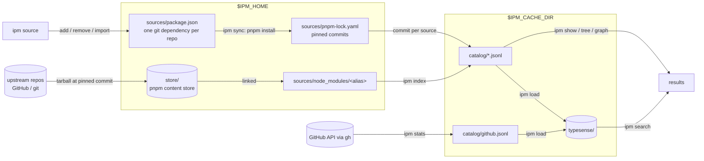

# Architecture

How `ipm` turns a list of repos into a searchable catalog of agent artifacts, and why it is built this way. For day-to-day use see the [user guide](user-guide.md); for the sources files see the [sources reference](sources-reference.md). The full design, including the parts not yet built, is [the ipm design](superpowers/specs/2026-10-09-ipm-design.md).

## Purpose and boundaries

`ipm` lets a person find agent artifacts — skills, agents, commands, hooks, MCP servers, plugins, Copilot plugins and marketplaces — across many upstream repos. It owns three things: the user's **sources** (a pnpm project listing repos of interest), the **catalog** built from them, and a local **search index** over the catalog.

It deliberately does not own fetching (pnpm does that), upstream content (read in place, never modified or executed), or installation into Claude Code. Building Claude Code plugins from picked items (packs and `ipm install`) is part 3 of the design and is not built yet.

## System overview



## Where things live

Paths are resolved in `internal/paths`, following pnpm's conventions. Both roots must be absolute.

| Root | Override | macOS | Linux | Windows |
| --- | --- | --- | --- | --- |
| Home | `IPM_HOME` | `~/Library/ipm` | `$XDG_DATA_HOME/ipm`, else `~/.local/share/ipm` | `%LOCALAPPDATA%\ipm` |
| Cache | `IPM_CACHE_DIR` | `~/Library/Caches/ipm` | `$XDG_CACHE_HOME/ipm`, else `~/.cache/ipm` | `%LOCALAPPDATA%\ipm\cache` |

`XDG_DATA_HOME` and `XDG_CACHE_HOME` are honoured on every OS. The home holds what a user would lose — `sources/` (`package.json`, `pnpm-lock.yaml`, `node_modules/`, the generated `.pnpmfile.cjs`) and `store/`, a pnpm store dedicated to `ipm` (pnpm's docs say a store is for mutually trusted users and processes). The cache holds what `ipm` can rebuild: `catalog/` and `typesense/`.

Nothing is kept in this checkout, so every command works from any directory.

## Sources

`internal/sources` owns `sources/package.json`: `{"name":"ipm-sources","private":true,"dependencies":{…}}`, one entry per repo, keyed by an alias (`owner--repo`, lowercased) with a pnpm specifier (`github:owner/repo[#ref]` or `git+<url>[#ref]`). `ipm source add`, `remove` and `import` edit it; adding a repo already listed, or one whose alias collides with another's, is refused. `Checkouts` pairs each source with `node_modules/<alias>` (symlinks resolved) and the 40-character commit in its `pnpm-lock.yaml` entry; a source missing either is an error that says to run `ipm sync`.

## `ipm sync`

1. Find pnpm (`internal/cli/pnpm.go`): pnpm from PATH if its major version is 12 or more, else `npx -y pnpm@12.10.1`; with neither, an error naming pnpm.
2. Write `sources/.pnpmfile.cjs`.
3. Run `pnpm install` (with `--upgrade`, `pnpm update --latest`) with `--ignore-scripts --store-dir <home>/store --dir <home>/sources`.
4. If pnpm fails, print its output and exit 1; the catalog is left as it was. Otherwise run `ipm index`.

### Why the pnpmfile

pnpm fetches a GitHub dependency as a codeload tarball but treats it as a git-hosted package and re-packs it with npm's packing rules (`package.json` `files`, `.npmignore`). For repos that are also npm packages that strips the agent content — `nizos/tdd-guard` went from 429 files to 3. The generated `.pnpmfile.cjs` does two things:

- a custom fetcher (pnpm 12's `fetchers` hook, `{ delegate }` form) that fetches the same commit as a plain `https://github.com/<owner>/<repo>/archive/<sha>.tar.gz` tarball, which pnpm unpacks as it is;
- a `readPackage` hook that empties every source's `dependencies`, `optionalDependencies` and `peerDependencies`, so their npm dependencies are never installed.

Non-GitHub sources (`git+https`, `git+ssh`, `git+file`) do not match the fetcher and still go through pnpm's git fetcher, so npm's packing rules can still drop files from them.

## Catalog

`ipm index` turns the synced sources into a searchable record of what they hold, without copying anything. It reads only `sources/node_modules` and `pnpm-lock.yaml`, so the same pins always produce byte-identical files (records sorted by ID, one per line). The catalog is rebuildable and lives in the cache; it is not committed anywhere.

- **Walk** (`internal/catalog/walk.go`) finds markers: `SKILL.md`, `agents/**/*.md`, `commands/*.md`, `hooks/hooks.json`, `.mcp.json`, `.claude-plugin/plugin.json`, Copilot `plugin.json`, `.claude-plugin/marketplace.json`.
- **Parse** (`parse.go`, `plugin.go`) turns each into a record: stable ID, repo, commit, path, the frontmatter or JSON verbatim as `meta`, a content hash. Frontmatter that is not strict YAML falls back to plain `key: value` lines, with the error kept on the record.
- **Link** (`link.go`) decides which plugin owns which component by Claude Code's own rules — skills add to `skills/`, agents and commands replace their defaults, hooks and MCP merge — and resolves marketplace entries to local, inline or external plugins.
- **Build** (`build.go`) adds a `repo:` record per source and per external source repo, and the reverse links: each component's `plugins`, each plugin's `marketplaces`.
- **Stats** (`internal/github`) are kept apart in `github.jsonl` because stars change daily; `ipm stats` refreshes them on demand through `gh`, and `ipm index` leaves the file alone.

An external plugin's catalog ID (`plugin:<marketplace repo>#<name>`) can be given to `ipm source add`, which adds the repo the plugin lives in. Record fields are in [the catalog spec](superpowers/specs/2026-10-08-artifact-catalog-design.md#data-model).

## Search

`ipm serve` runs Typesense 30.2 in Docker as container `ipm-typesense` on `127.0.0.1:8108`, with its data and API key in `<cache>/typesense/`. If a container from the aihs days (`aihs-typesense`) exists, `serve` removes it first, since it holds the port; run `ipm load` afterwards. `ipm load` rebuilds one collection, `artifacts`, from `catalog/*.jsonl` and `github.jsonl`: one document per record, with its repo's stars (an external plugin takes its source repo's), its owning plugins' names, and an embedding Typesense computes itself with its built-in `ts/all-MiniLM-L12-v2` model. The index is disposable — the catalog is the record — so there is no incremental sync.

`ipm search` runs hybrid search by default: keyword matching over name (weight 4), description, tags (2 each) and plugin names (1), fused with semantic matching on the embedding (Typesense's rank fusion, 0.7 keyword / 0.3 vector), ties broken by stars. `--keyword` turns semantics off for comparison. The SCORE column is the hybrid rank-fusion score × 100 — relative standing within one query, not comparable across queries — or, with `--keyword`, the keyword score as a percentage of the best hit's. `--explain` adds KW (✓ for a keyword match, — for semantic-only) and SEM (semantic similarity, 1 − cosine distance, comparable across queries). `--page N` pages through results; `--all` fetches every page, 250 at a time — in hybrid mode that is the keyword matches plus about 100 semantic neighbours. `#` and `+` are indexed, so `c#` and `c++` are words. The code is `internal/typesense` (a plain `net/http` client) and `internal/search` (documents, schema, parameters, the results table).

`ipm show`, `ipm tree` and `ipm graph` read the catalog only, through `internal/catgraph`: repos contain their marketplaces, marketplaces list plugins, plugins own components, and an external plugin points at its source repo — so `tree --up` from a skill also shows which other marketplaces list its repo.

## `ipm doctor`

One row each for `home`, `cache`, `pnpm` (the version, and whether it runs through `npx`), `sources` (count; a warning if not all are synced), `catalog` (record count; a warning if not built), `docker`, `typesense` and `claude` (a warning if not on PATH). A missing home or pnpm is a problem and exits 1; warnings do not.

## Code layout

```text
cli/
├── cmd/ipm/main.go           process wiring only: argv, real commands, HTTP client, exit codes
└── internal/
    ├── cli/                   command table, help, one file per command; pnpm.go (find pnpm, .pnpmfile.cjs)
    ├── paths/                 IPM_HOME, the cache dir, the folders under them
    ├── sources/               sources/package.json, aliases, pnpm-lock.yaml commits
    ├── catalog/               walk, parse, link, build; *.jsonl read and write
    ├── github/                GitHub stats through gh
    ├── typesense/             Typesense HTTP client
    ├── search/                documents, schema, parameters, results table
    ├── catgraph/              the catalog as a graph; tree and graph rendering
    ├── scan/                  the folder report behind ipm scan
    ├── pack/                  naming rules; reading an aihs-era manifest.toml for source import
    ├── copilot/               the skills a Copilot plugin.json lists (kept for part 3)
    └── marketplace/           marketplace.json entries and atomic Write (kept for part 3)
```

Commands reach the outside world only through `cli.System` (stdout, stderr, environment, `LookPath`, an `Output` runner for pnpm, docker, gh and claude, an HTTP client and a clock). `bin/ipm` at the checkout root is a shell shim: it rebuilds `cli/bin/ipm` when a Go source changes and execs it; `.envrc` puts `bin/` on PATH.

## Decisions

| Decision | Rationale |
| --- | --- |
| pnpm is the fetcher, pinner and store | It already solves fetching git dependencies, pinning them in a lockfile, a shared content-addressable store and cheap linking; `ipm` doesn't reimplement any of it. |
| Always `--ignore-scripts`; sources' npm dependencies emptied | Sources are content, not code. No upstream file is ever executed. |
| A generated `.pnpmfile.cjs` fetches GitHub commits as plain tarballs | pnpm's re-packing with npm's rules dropped agent content from repos that are also npm packages. Needs pnpm 12's custom fetchers, hence the pnpm 12 floor and the `npx` fallback. |
| A dedicated pnpm store under the home | A pnpm store is for mutually trusted users and processes; agent repos are kept apart from a user's normal store. |
| Sources and catalog per user, in platform data and cache folders | Like pnpm's registry config and metadata cache: one list of interests per person, usable from any project. The catalog is rebuildable, so it is cache, not data. |
| Catalog kept separate from GitHub stats | The catalog is a pure function of the pinned commits; stars change daily and are refreshed on demand. |
| Disposable search index | The catalog is the record; `ipm load` rebuilds the index rather than syncing it. |
| All commands in Go, one test suite | One language, and every command is testable in-process through `cli.System`. |

## Testing

`mise run cli:test` runs `gofmt`, `go vet` and `go test ./...`:

- `internal/paths` resolves defaults and overrides for macOS, Linux and Windows, and refuses relative paths and a missing home.
- `internal/sources` tests aliases, the `package.json` round trip, duplicate and colliding repos, and reading commits from a fixture `pnpm-lock.yaml`, including unsynced cases.
- `internal/catalog`, `internal/catgraph`, `internal/search` and `internal/typesense` test the catalog, the graph and search against fixtures and an `httptest` server.
- `internal/cli` drives every command in-process with a fake `System` and temp `IPM_HOME`/`IPM_CACHE_DIR`: the exact pnpm arguments, the generated `.pnpmfile.cjs`, the `npx` fallback for an old pnpm, a failed pnpm leaving the catalog intact, doctor rows.
- `cmd/ipm` builds the real binary and checks exit codes; when pnpm is installed it also runs `source add`, `sync` and `index` against a local git repo over `file://`.

## Extending

- **A command** — add `internal/cli/<name>.go` with a `<name>Flags()` returning its `flag.FlagSet` and run function, and a row in the `commands` table in `cli.go`. Get data folders from `ipmPaths(sys)`.
- **Another artifact type** — add a marker to `internal/catalog/walk.go`, a parser, a type in `catalog.Types` with its file, and fixtures.
- **Packs and plugins** — part 3 of [the ipm design](superpowers/specs/2026-10-09-ipm-design.md): `ipm.toml`, `ipm pack`, and `ipm install` building `.ipm/plugins/<pack>/` at project or user scope.
