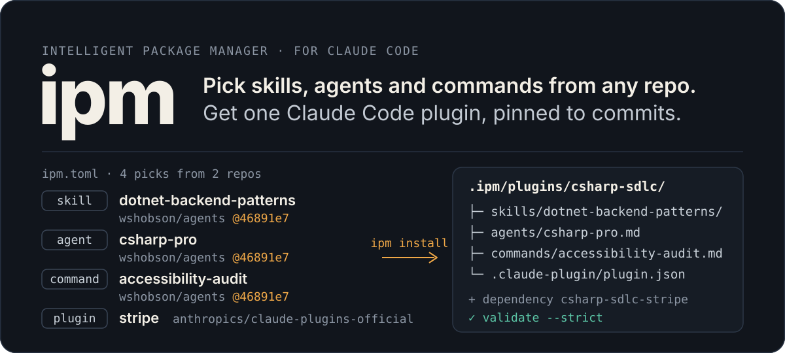
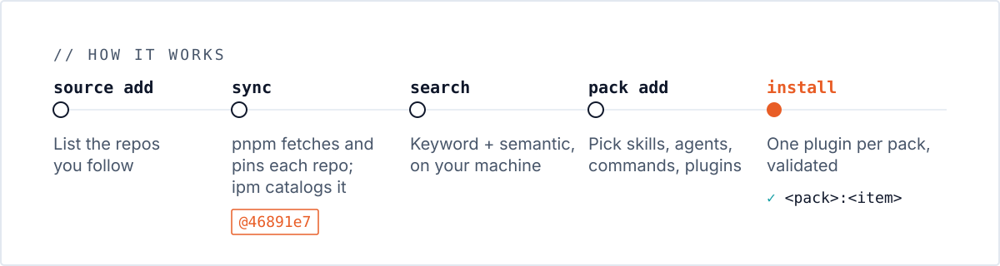

The intelligent package manager for agent artifacts. Find skills, agents, commands, hooks, MCP servers and plugins across every repo you follow, then pick the ones you want into your own Claude Code plugin, pinned to the commits you picked from.
{: .fs-6 .fw-300 }

[Get started](getting-started.md){: .btn .btn-primary .fs-5 .mb-4 .mb-md-0 .mr-2 }
[View on GitHub](https://github.com/thinkjones/intelligent-package-manager){: .btn .fs-5 .mb-4 .mb-md-0 }

---

## The problem

Good agent artifacts are scattered across hundreds of repos and marketplaces. Installing a whole plugin to get one skill drags in agents, hooks and MCP servers you didn't want, under names you don't control, at whatever commit happens to be current.

## What ipm does



1. **Follow repos.** `ipm source add obra/superpowers` adds a repo of interest. `ipm sync` has [pnpm](https://pnpm.io) fetch every repo and pin it to a commit.
2. **Catalog them.** `ipm sync` also builds a catalog of everything those repos hold: one record per repo, marketplace, plugin, skill, agent, command, hook and MCP server, linked to what owns it.
3. **Search.** `ipm search "c# testing"` runs hybrid keyword and semantic search over the catalog, on a local Typesense server. `ipm tree` and `ipm graph` show where anything comes from.
4. **Pick into packs.** `ipm pack add my-pack <id>…` collects skills, agents, commands and whole plugins from any of your repos into a named pack in your project's `ipm.toml`.
5. **Or do it all in one screen.** `ipm tui` searches, shows relationships, collects into packs and builds, with keys instead of IDs.
6. **Build plugins.** `ipm install` builds each pack into a Claude Code plugin and a local marketplace under `.ipm/`. Your picks load as `my-pack:<item>`; whole plugins come along as pinned dependencies.

```bash
ipm source add obra/superpowers wshobson/agents
ipm sync
ipm serve && ipm load
ipm search tdd --type skill

ipm pack new my-pack --description "My picks"
ipm pack add my-pack 'skill:obra/superpowers:skills/test-driven-development'
ipm install
claude plugin marketplace add ./.ipm
```

## Why it is different

- **Pinned and reproducible.** Every item is pinned to a commit in `.ipm/ipm.lock`. Commit it, and a teammate who runs `ipm install` gets byte-identical plugins.
- **No upstream code runs.** pnpm always runs with `--ignore-scripts`, and repos' own npm dependencies are never installed. Sources are content, not code.
- **Your namespace.** Picked items load under your pack's name, not a dozen upstream plugin names.
- **Built on pnpm.** Fetching, pinning, a content-addressable store and cheap linking come from pnpm; `ipm` doesn't reinvent them.
- **You stay in control.** `ipm` writes a marketplace; it never changes your Claude Code configuration. You add the marketplace yourself.

## Where next

| If you want to | Read |
| --- | --- |
| Install `ipm` and run it for the first time | [Getting started](getting-started.md) |
| Understand sources, the catalog, packs and scopes | [Concepts](concepts.md) |
| Build a plugin from items in several repos | [Build your own plugin](guides/build-a-plugin.md) |
| Look up a command or flag | [Commands](reference/commands.md) |
| Fix an error message | [Troubleshooting](troubleshooting.md) |
| Know how it works inside | [How it works](architecture.md) |
